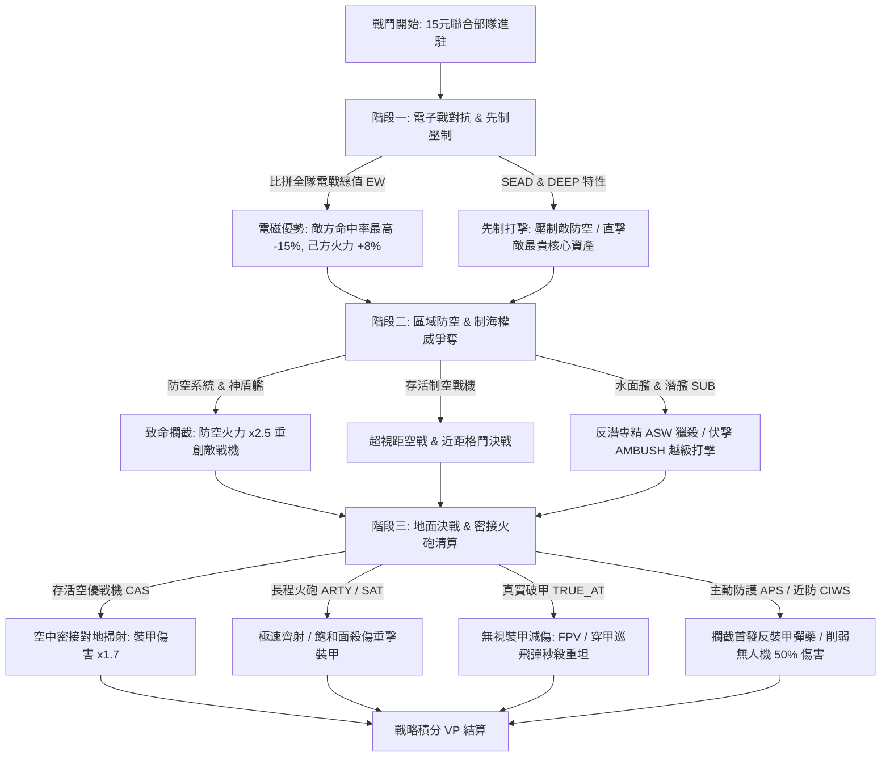

# 頂尖對戰：15元聯合作戰 (TopClash)

> **極限軍武預算決策 · 三階段聯合作戰推演引擎 · 100 款現代軍武全鑑**  
> 一分鐘一局、確定性隨機種子、全差異化 100 款現代軍武、三階段多維攻防結算、Web Audio 即時合成音效、精選對戰挑戰、HTML5 Canvas 戰報海報。

[](https://github.com/muchliver/TopClash)
[](#軍武庫全鑑系統-armoryhtml)
[](#1-組隊規則-deck-building)
[](#技術架構與特色-tech-stack)

---

## 🎮 玩法指引 (Gameplay Guide)

### 1. 組隊規則 (Deck Building)
- **總作戰預算**：固定 **$15**（快速對戰若勾選「情報先制偵察」則扣減 $1 為 $14）。
- **五大兵種聯合作戰槽位**（聯合作戰原則：**同一類型不可重複選取**，必須各兵種挑選 1 款達成 5 兵種聯隊）：
  1. ✈️ **制空槽 (AIR)**：配置制空打擊戰機，負責爭奪制空權、攔截巡弋飛彈與地面密接支援。
  2. 🛡️ **裝甲槽 (ARM)**：配置重裝鐵騎主力戰車或步兵戰車，掌控地面戰線控制分與近身突擊。
  3. 🚀 **防空槽 (ADS)**：配置區域防空或野戰反導系統，階段二提供 2.5 倍致命攔截火力抵禦空襲。
  4. ⚓ **制海槽 (NAV)**：配置神盾驅逐艦、巡防艦、匿蹤潛艦或飛彈快艇，兼顧防空掩護與海權控制。
  5. 📡 **支援槽 (ISR)**：配置預警機、電戰機、無人機、自走砲或長程火箭，掌握全戰場電磁與火力先手。
- **自由旗艦配置**：完全解除高價裝備限制，只要總金額 ≤ $15 且滿 5 槽，可自由組建雙旗艦陣型（如 $5+$5+$3+$1+$1=$15）或中堅均衡隊形。
- **四大聯合作戰兵種羈絆 (Combined Arms Synergies)**：
  - **📡 協同接戰網 (CEC / Link-16)**：預警機＋神盾艦/高階防空 ➔ 階段二防空攔截倍率 `+0.35`、全隊命中率 `+5%`。
  - **🛸 有人無人協同 (MUM-T)**：五代隱身機＋察打/巡飛無人機 ➔ 階段一先制打擊或首輪對地傷害 `+18%`。
  - **🌊 立體海空獵殺網 (ASW Net)**：反潛艦艇＋潛艦/反潛機 ➔ 對敵方海面與水下目標傷害 `+20%`。
  - **⚙ 步坦砲協同鐵拳 (Combined Arms Iron Fist)**：重裝甲戰車＋長程火砲＋野戰近防 ➔ 主戰車額外 `10%` 減傷、火砲齊射傷害 `+15%`。

---

### 2. 100 款現代軍武體系 (5 兵種 × 5 價位 × 4 風格 A/B/C/D)
全庫收錄全球 **100 款真實服役/最新研發軍武**，數值矩陣全面差異化，絕無重複數值：

| 兵種分類 | $5 頂級旗艦 | $4 戰區中堅 | $3 骨幹主力 | $2 經濟實用 | $1 消耗平價 |
|---|---|---|---|---|---|
| **制空打擊 (AIR)** | F-22, 殲-20A, 蘇-57, F-35A | 陣風, 颱風, F-15EX, 蘇-35S | F-16V, JAS-39E, 幻象2000-9, 殲-10C | FA-50, 梟龍, 幻象2000-5, F-5E改 | A-29巨嘴鳥, 米格-21, 雅克-130, L-159 |
| **重裝鐵騎 (ARM)** | M1A2 SEPv3, 豹2A8, T-14阿瑪塔, 梅卡瓦Mk4 | K2黑豹, 挑戰者3, 勒克萊爾, 99A式 | T-90M, 10式, M1A1 SA, 豹2A4改 | T-72B3, 史崔克, 拳獅犬, 雲豹CM-34 | 武裝豐田皮卡, T-55改, M113拖式, 悍馬TOW |
| **區域防空 (ADS)** | 愛國者PAC-3, S-500, S-400, 大衛投石索 | SAMP/T, 鐵穹+大衛, 天弓三型, 紅旗-9B | NASAMS增程, IRIS-T SLM, 山毛櫸M3, 紅旗-16 | 鎧甲-S1, 獵豹Gepard, 復仇者, 天劍二型陸射 | 刺針小隊, 針式小隊, 星光飛彈, 歐瑞康35mm快砲 |
| **制海權威 (NAV)** | 伯克級Flight III, 055型大驅, 世宗大王級, 45型勇敢級 | 維吉尼亞級, FREMM, 最上級, 亞森級M | 基洛級, 蒼龍級, 212A型, 康定級(拉法葉) | 沱江級, 22型快艇, 追風級, 薩爾6型 | 自殺無人快艇群, 武裝突擊艇, 雄三岸置車, 特戰微型潛艇 |
| **支援打擊 (ISR)** | E-7預警機, B-21突襲者, 空警-500, RQ-4全球鷹 | M142海馬斯, EA-18G咆哮者, ATACMS, 風暴暗影 | PzH 2000, 龍捲風-S, 凱撒自走砲, 弓箭手Archer | MQ-9死神, TB-2察打, 彈簧刀600, 獵戶座Orion | FPV自殺無人機, 民用無人機校射, 彈簧刀300, 迫擊砲小隊 |

---

### 3. 三階段確定性推演引擎 (Deterministic 3-Phase Engine)
戰鬥過程完全根據雙方數值、電戰差額、相剋機制與戰術特性進行精確計算：



- **階段一：電子戰與先制壓制 (EW & Suppression)**
  - 比拼雙方全隊電戰值（EW），差距每 10 點觸發顯著電磁優勢（最高降低敵方 15% 命中率，提升己方 8% 火力）。
  - `SEAD`（防空壓制，如海馬斯、彈簧刀300）優先狙殺敵方雷達防空車。
  - `DEEP`（縱深打擊，如 B-21、ATACMS、F-35A）開局直取敵方最昂貴核心旗艦。
- **階段二：區域防空與制海爭奪 (Air Defense & Naval Dominance)**
  - 防空系統與神盾艦（`AEGIS`）對敵方戰機展開 ×2.5 毀滅性攔截。
  - 存活戰機展開超視距空戰（`LR` 提高命中率）。
  - 水面艦艇、潛艦（`SUB` 高隱匿、傷害加成）與反潛巡防艦（`ASW` 傷害 ×1.6）展開海戰。
- **階段三：地面決戰（2 輪）(Ground Climax & Fire Support)**
  - 存活戰機實施空中密接支援（`CAS`，對裝甲傷害 ×1.7）。
  - 雙方主力戰車正面對轟，長程火砲（`ARTY`、`SAT`）持續曲射支援。
  - `TRUE_AT`（真實破甲，如 FPV、彈簧刀600、M113拖式）無視防禦減傷，直接貫穿頂裝甲。
  - `APS`（主動防護系統，如梅卡瓦、豹2A8、T-14）自動無損抵禦第一波致命打擊。
  - `CIWS`（近防火網，如鐵穹、獵豹、鎧甲）自動減半無人機群傷害。

---

### 4. 戰略積分 (VP) 結算公式
- **殘餘戰力分（滿分 60 分）**：$\sum (\text{存活單位費用} \times \text{剩餘血量\%} \times 4)$。
- **戰線控制分（滿分 30 分）**：裝甲部隊掌控分（最高 15 分）＋ 空優控制分（10 分）＋ 海權控制分（5 分）。
- **以小博大分（上限 12 分）**：低價位裝備越級擊毀高價位裝備之價差 × 2。
- **勝負裁決**：若一方全軍覆沒，存活方直接達成「全面戰術殲滅」獲勝；否則由總積分高者判定勝利。

---

## 📚 軍武庫全鑑系統 (`armory.html`)

遊戲內建專屬 **軍武庫全鑑圖鑑系統**，玩家可隨時切換查閱全部 100 款武器詳細規格：
- **動態多重檢索**：支援關鍵字即時搜尋、5 大兵種分類篩選、1~5 元價位快速過濾。
- **全息情報模態窗 (Holographic Modal)**：
  - 展示武器官方原廠高解析戰鬥照片。
  - 產地國旗、官方製造商/研發單位、主武裝系統說明。
  - 五維戰術雷達數值評等（火力、防護、機動、隱匿、電戰）。
  - 完整戰術特性標籤解析與相生相剋指引。
- **戰術音效試聽**：內建 Web Audio 即時合成試聽（飛彈呼嘯、長程重砲、鏈砲速射、魚雷入水、EMP 電磁脈衝、自殺蜂群）。
- **一鍵導航組隊**：在圖鑑中可點選「帶入作戰配置」，自動導回主遊戲並選定該款武器！

---

## 🔍 全軍火庫 100% 官方照片嚴審體系 (`audit_sheet.html`)

為確保最高軍事實證水準，全庫照片進行過嚴密的人工視覺檢核：
- **消滅一切非戰備圖資**：徹底淘汰 3D 灰白渲染圖、展板合影照片、遊客自拍、夜間黑影剪影、2D 圖紙藍圖等。
- **100% 官方與製造商授權實機**：選用美軍 DVIDS、英國皇家海軍、法國國防部、德國萊茵金屬/Diehl、中國軍工、以色列拉斐爾、烏克蘭軍方等一線部隊真實演訓特寫。
- **16:9 黃金視覺比例**：全部圖片以 PIL 演算法標準化裁切，兼顧手機與桌面端最震撼的戰術視覺。
- 可直接開啟 [audit_sheet.html](file:///C:/Users/XQ/.gemini/antigravity-ide/scratch/defense-budget-15/audit_sheet.html) 檢視全量 100 款軍武審查大表與 Contact Sheets。

---

## 🛠️ 技術架構與特色 (Tech Stack)

1. **極致輕量原生架構**：
   - 核心：HTML5 語意化標籤 + 原生 JavaScript (ES6+)。
   - 樣式：純 Vanilla CSS，無 Tailwind 或重量級第三方 CSS 依賴，包含玻璃擬態（Glassmorphism）、微發光邊框、流體金屬質感。
2. **Web Audio API 零依賴即時音效合成**：
   - 無需加載任何龐大外部音頻檔案，透過原生振盪器（OscillatorNode）、白色噪音緩衝（AudioBuffer）與雙極點濾波器（BiquadFilterNode）純演算法合成：
     - `missile`（超音速飛彈呼嘯與高空穿雲）
     - `heavy_cannon`（155mm 重型榴彈砲深沉低音炮決）
     - `cannon` / `flak`（30mm 鏈砲與防空高爆密集火網）
     - `torpedo`（深海主動聲納水下回響與渦輪爆炸）
     - `emp_pulse`（全頻段電子戰脈衝掃描蜂鳴）
     - `swarm`（FPV / 巡飛彈高轉速無刷馬達高頻蜂鳴）
3. **HTML5 Canvas 戰術戰報海報 (Victory Poster)**：
   - 戰鬥勝利後可一鍵生成 1200×675 像素高解析戰術總結海報，即時將部隊配置、VP 積分、擊破戰果繪製為專業戰術海報並供玩家下載分享。
4. **雙軌響應式 (RWD) 體驗**：
   - **桌機版**：5×5 矩陣全景看板一屏盡收，懸停 HUD 即刻感知戰力。
   - **手機版**：專屬左右滑動切換兵種分頁橫軸（Touch Swipe）、底部戰情情報抽屜（Bottom Sheet）、雙行緊湊常駐指揮台。

---

## 📁 專案目錄結構

```
TopClash/
├── index.html              # 主遊戲頁面（5x5看板、預算配置、戰鬥動畫、戰報海報）
├── armory.html             # 軍武庫全鑑圖鑑系統（100款軍武檢索、全息彈窗、音效試聽）
├── audit_sheet.html        # 全庫 100 款武器照片官方視覺審查大表
├── manifest.json           # PWA 應用程式資訊清單
├── sw.js                   # Service Worker 離線快取引擎 (Cache-First + Network-First)
├── style.css               # 軍事戰術 HUD 樣式表（深淺雙主題、桌機/手機雙軌樣式）
├── all_units.json          # 100 款軍武完整 JSON 資料集
├── .gitignore              # Git 版本控制忽略設定
├── README.md               # 專案完整說明與玩法手冊
├── CHANGELOG.md            # 專案完整版本演進與詳細更新日誌
├── assets/
│   └── units/              # 100 款軍武官方 16:9 高清實裝照片 (*.jpg，已瘦身72%)
├── contact_sheets/         # 5 大兵種全覆蓋視覺印樣圖集 (*.jpg)
├── js/
│   ├── data.js             # 100 款軍武數值矩陣、特性常數、各國元數據、四大聯合作戰羈絆
│   ├── engine.js           # 種子化三階段推演引擎、VP 結算、沙盒大數據模擬
│   ├── ladder.js           # 天梯段位積分系統、防守教條自選與雲端影子鏡像
│   ├── tournament.js       # 單機世界盃淘汰錦標賽對抗樹與進程引擎
│   ├── firebase-tourney.js # 雲端多人錦標賽、Commit-Reveal 防窺探協議與原子入房
│   ├── online-pvp.js       # BO5 真人雙人 WebRTC P2P 連線與 Firebase 斷線中繼
│   └── app.js              # 介面互動、Web Audio 音效、Canvas 戰報、手機抽屜、AAR 單兵儀表板
├── tools/
│   └── balance.js          # 6,000 場循環賽平衡性模擬工具
└── docs/
    ├── SPECIFICATION.md       # 詳細技術規格
    └── BALANCE_REPORT.md      # 數值平衡與流派相剋驗證報告
```

---

## 🚀 歷史版本演進 (Changelog)

> 完整詳細之功能迭代、修復紀錄與架構更新請參閱 📄 [**CHANGELOG.md**](CHANGELOG.md)。

- **v4.4.0 (2026-10-30) — A/B 陣容切換鈕字體放大與模組間距呼吸感優化 (A/B Toggle Typography & Deck Gap Polish)**
  - **A/B 字體放大**：字母 A/B 提升至 14.5px (800 字重)，體量飽滿大氣，與右側預算數字高度協調。
  - **模組間距舒展**：A/B 膠囊與作戰預算間距由 8px 擴增至 15px，消除緊貼壓迫感。
  - **快取升級**：更新 Service Worker 快取至 `topclash-v4.3.4`。

- **v4.3.3 (2026-10-30) — 預算小圓點進度條移除與開戰按鈕旗艦級拓寬 (Budget Mini-bar Removal & Launch Button Expansion)**
  - **移除進度條小圓點**：清除預算下方 15 顆小圓點 (#budgetMiniBar)，消除「...」殘留視覺感。
  - **開戰按鈕旗艦拓寬**：左欄收緊至 72px，多出的版面讓渡給右側開戰按鈕，拓寬至 265~295px，主副標題字體與圖標同步升級。
  - **快取升級**：更新 Service Worker 快取至 `topclash-v4.3.3`。

- **v4.3.2 (2026-10-30) — 手機端 RWD 行動結構隔離與響應式雙端架構加固 (Mobile RWD Isolation & Dual Layout Hardening)**
  - **雙端嚴格隔離**：桌機端大氣排版封裝於 `min-width: 769px`，手機端繼承雙層行動指揮架構。
  - **手機版極致體驗**：上層預算與隨機/抽屜按鈕精確對齊，下層 100% 滿版開戰大按鈕，杜絕橫向溢出。
  - **快取升級**：更新 Service Worker 快取至 `topclash-v4.3.2`。

- **v4.3.1 (2026-10-30) — 底部作戰指揮台精確幾何自適應排版修復 (Command Deck Geometry & Anti-Overlap Hotfix)**
  - **杜絕重疊**：三欄改用 Flexbox 嚴格邊界隔離，修復中欄向左溢出覆蓋預算數值、向右被開戰按鈕遮擋之缺陷。
  - **開戰按鈕黃金尺寸**：開戰按鈕精修為 215~245px，確保文字 100% 完整無截斷且絕不遮擋鄰近按鈕。
  - **三大卡片自適應**：中欄卡片艙高度維持 40px 飽滿規格，加入 < 1320px 響應式微調，完美相容各種桌面解析度。
  - **快取升級**：更新 Service Worker 快取至 `topclash-v4.3.1`。

- **v4.3.0 (2026-10-30) — 戰術指揮台大氣重構與頂部雙排導航全景升級 (Command Deck Grand Layout & Dual Header Elevation)**
  - **預算儀表精簡**：移除左下重複之「槽位」與「結餘」膠囊，重構為大氣的雙層戰術儀表與加大 A/B 切換鈕。
  - **三大按鈕群大氣展開**：戰術教條、體系指示燈與編制工具三大卡片群全面統一升級為 44px 飽滿高度，字體提升至 12.5~13.5px 並水平居中。
  - **開戰按鈕拓寬零截斷**：解除 190px 鎖死限制，拓寬為 270~330px，開戰字樣與快捷提示 100% 完整無裁切顯示。
  - **頂部雙排大氣升級**：主導航提升至 54px、戰情橫幅提升至 46px，字體與功能鈕同步加大，全站 100vh 高度公式自適應更新。
  - **快取升級**：更新 Service Worker 快取至 `topclash-v4.3.0`。

- **v4.2.9 (2026-10-30) — 遊戲說明彈窗全主題對比度深度強化與快取更新 (Help Modal Contrast Polish & SW Refresh)**
  - **說明字體對比度修復**：徹底解決 `.help-card ul` 原寫死淡灰色在淺色模式白底背景下太淡看不清的問題，改用 `var(--text)` 與 1.6 行高。
  - **淺色模式高對比強化**：淺色模式下內文與清單全面升級為深墨藍黑（`#1e293b`），重點標籤 `<b>` 採用深湛藍加粗，視覺層次分明。
  - **Service Worker 快取版本升級**：更新快取至 `topclash-v4.2.9`，確保終端即時更新最新樣式。

- **v4.2.8 (2026-10-30) — 四星將官星陣零裁切修復、10 級天梯軍階級距全面擴展與千分挑戰階梯**
  - **四星將官星陣 2×2 零裁切重構**：將四星分割為獨立網格元素，以標準 2×2 軍規矩陣居中排列於 50px×50px 徽章內，徹底終結外側星星被圓角裁切問題。
  - **10 級將校軍制級距全面擴展**：四星上將擴大為 **2,000 ~ 2,999 RP（1,000 分大級距）**；特級上將門檻拔高至 **3,000+ RP（對標 TOP 10 頂尖殿堂，最高 3,500 RP）**，為玩家打造攀登頂峰的充實挑戰感；全面擴大中低軍階厚度。
  - **名冊重劃與自動遷移**：100 強名冊平滑重劃為 3,500 ➔ 250 RP 單調曲線，舊版存檔自動平滑過渡，玩家名次、RP 與呼號完整保留。

- **v4.2.7 (2026-10-30) — 全域使用者資訊與軍階位階統一同步 (Universal Commander Profile & Military Rank Unification)**
  - **頂部 HUD 與天梯軍階即時同步**：解決頂部狀態列顯示「准尉」與天梯左側戰情卡顯示「四星上將」的不一致問題；將全域軍階評估函數 calcRankTitle(rp) 正式對齊天梯 10 級軍制（作戰少尉 ➔ 特級上將），由 LadderEngine.getRankTier 集中驅動。
  - **頂部 HUD 動態金色階級標籤**：#hudPlayerBadge 內的軍階徽章升級為與位階顏色即時連動的金黃邊框標籤（#fbbf24），並增設點擊直跳天梯戰情室之便捷導航功能。
  - **全生命週期聯動觸發**：指揮官改名、天梯對戰結算 RP 變動時，即時觸發 
enderHud() 同步更新頂部導航列呼號與軍階，各頁面指揮官身份徹底一致。

- **v4.2.6 (2026-10-30) — 指揮官戰情室大氣重構、常用編制彈出修復與底欄常駐戰術指示燈 (C4ISR HUD Refactor & Indicator Dock)**
  - **天梯左欄作戰指揮中心大氣重構**：左欄拓寬至 500px，三柱核心戰況（排名、RP、作戰令）數據放大至 20px 粗體；「🛡️ 當前戰鬥部隊」軍武縮圖放大至 44px；「駐防 AI 戰術教條」升級為三等分軍規分段切換器；交戰守則輕量化釋放垂直呼吸空間。
  - **修復編制代碼選單向上彈出**：解除 command-deck 與 deck-mid 的溢出裁剪（overflow: visible），選單流暢完整向上彈出。
  - **底欄工具組冷暖分區**：以科技戰略藍外框獨立包覆【🎲 隨機補滿】、【🗑️ 清空】、【📋 編制 / 代碼 ▾】，與左側暖金教條形成鮮明對比。
  - **常駐聯合作戰指示燈槽 (Fixed Tactical Indicator Dock)**：4 大體系（CEC、MUM-T、ASW、LAND）與電磁平衡燈常駐固定寬度顯目化，未達成時暗淡待命，達成時發光點亮，徹底消除陣容切換時底欄按鈕左右跳動。

- **v4.2.5 (2026-10-30) — 全球 TOP 10 頂尖殿堂、國旗版面基線定寬與戰術用語精煉**
  - **正名「🏆 全球 TOP 10 頂尖指揮官」**：精確收錄全服排名前 10 強特級上將，殿堂榮譽感倍增。
  - **國籍旗幟寬度鎖定與基線校準**：新增 .r-flag 28px 定寬容器，消除不同國旗 emoji 寬度不一造成的指揮官名稱垂直基線歪斜。
  - **用語精煉**：「戰術教條保密」精簡為「戰術保密」，「當前特遣編制 (攻守常備)」精簡為「當前戰鬥部隊」。

- **v4.1.4 (2026-10-29) — 結算報告各單位傷害統計槽位順序嚴格對齊 (Unit Damage Meter Slot Alignment)**
  - **傷害統計表槽位順序 1:1 對齊**：結算報告「各單位傷害輸出與戰果明細」由原先依傷害降序排序改為嚴格依對戰槽位（Slot 1 制空 ➔ Slot 2 裝甲 ➔ Slot 3 防空 ➔ Slot 4 制海 ➔ Slot 5 支援）固定排列，並附帶兵種色彩縮寫（`AIR`/`ARM`/`ADS`/`NAV`/`ISR`），與戰鬥畫面卡片逐行對應。

- **v4.1.3 (2026-10-29) — 底欄「湊齊特定組合」與「(1/2) 進度提示」按鈕徹底移除、卡片情報脈絡化羈絆指引與體系圖鑑全鑑**
  - **指令台清爽通透**：徹底移除未選裝備（0/5）與選取 1 件時底欄出現的「(1/2) 組合提示按鈕」及巨型 Toast 彈窗，消除遮蔽畫面與打擾操作之困擾。
  - **卡片情報脈絡化提示 (getUnitSynergyHints)**：滑鼠懸停卡片或點開詳情抽屜時，直接標註「體系羈絆夥伴」（如五代機標註搭檔無人機、預警機標註搭檔神盾艦），決策時即時引導。
  - **漸進式亮起與說明圖鑑**：選取第 1 件裝備後底欄才動態浮現 `(1/2)` 進度；「遊戲說明 `?`」增設專屬四大體系圖文手冊。

- **v4.1.2 (2026-10-29) — 戰情橫幅膠囊排版重構、我方與假想敵資訊雙軌識別強化、指令台冗餘按鈕消除**
  - **AI 演習與全球幽靈膠囊單行排版**：徹底解決模式切換鈕上下擠壓折行問題，改為橫向水平流線型分段膠囊；精簡 `⚡ 快速交鋒` 標籤釋放寬度。
  - **我方戰績與假想敵雙軌識別**：頂部 HUD 明確標示「👤 我方：[呼號] · [軍階]」，戰情橫幅增設「🎯 當前假想敵」或「🤖 AI 對手」鮮明徽章，解決玩家個人戰績與對手資訊混淆問題。
  - **指令台冗餘按鈕消除**：桌面端徹底隱藏誤顯之手機抽屜按鈕（`戰術 ☰`），底欄專注於 `[ 編制 / 代碼 ▾ ]` 之核心代碼複製/匯入與自訂編制功能。

- **v4.1.1 (2026-10-29) — 淘汰錦標賽大廳與 HUD 結構整併、多模式雙向即時同步與旗艦電競版面優化**
  - **消除重複卡片，大廳與 HUD 狀態清晰整併 (`#tourneyHeader` & `#tourneyLobbyCard`)**：未開賽之大廳備戰階段自動隱藏獨立 HUD 卡片，將標題與動態模式狀態整合為大廳主卡頂部之「統一大廳旗艦抬頭 (Hero Lobby Header)」；開賽後自動收起大廳卡片並展現頂部 HUD 與世足對抗樹。
  - **單人／私人／公開三模式資料雙向即時同步**：修復切換模式分頁或點擊「賽事規模（4/8/16/32 強）」與「淘汰賽制（BO1/升級制/BO3）」時頂部資訊未響應之問題，即時聯動更新狀態 Badge（如 `🌐 公開隨機 · 8 強 (⚔️ 全程 BO3)`）與按鈕高亮。
  - **版面設計與 RWD 視覺深度美化**：微光漸層邊框與玻璃質感 Badge，桌面端雙欄排版緊湊零冗餘，行動端觸控友善防溢出。

- **v4.1.0 (2026-10-29) — 聯合作戰羈絆 1/2 進度引導、觸控詳情彈窗、賽後敵陣載入沙盒、天梯駐防教條自選與 PWA 快取正規化**
  - **羈絆半成品進度引導 (getPartialDeckSynergies)**：選取 1~4 件裝備時，若已具備某項聯合作戰羈絆的前置核心，指揮台即時顯示虛線引導標籤（如 🛸 有人無人協同 (1/2)），降低組隊門檻。
  - **全平台點擊/觸控彈出數值詳情 ([data-syn-tip])**：點擊或輕觸任意羈絆、電戰或盲點標籤，立即彈出完整觸發條件與加成數值 Toast；手機端「戰術 ☰」抽屜同步顯示羈絆與盲區。
  - **賽後戰報「🧪 載入敵陣至沙盒」一鍵反制演練 (#rLoadEnemySandbox)**：一鍵將剛交鋒的敵方 5 槽陣容與教條設為沙盒指定假想敵（custom_enemy），立刻執行 300 場蒙地卡羅模擬測試反制配裝。
  - **天梯駐防部隊「AI 戰術教條」自選 (#defenseDocRow)**：支援一鍵指定駐防部隊採用的 AI 戰術教條（先發制人／縱深防禦／電子欺敵），並同步至 Firebase 雲端與 TOP 30 排行榜。
  - **線上錦標賽 60 秒出擊等待進度條 (#tourneyWaitBarWrap)**：出擊鎖定等待對手期間，即時顯示動態倒數進度條與每秒狀態更新。
  - **360px 窄螢幕排版精修與 PWA 快取正規化**：優化小螢幕戰鬥小卡資訊密度，sw.js 啟用 ignoreSearch: true 確保離線 100% 快取命中。

- **v4.0.0 (2026-10-29) — 聯合作戰羈絆系統、C4ISR 單兵傷害儀表板、Commit-Reveal 盲交防作弊、手機雙欄橫向交火對抗戰場與圖片瘦身 72%**
  - **四大聯合作戰兵種羈絆 (SYNERGIES)**：導入「📡 協同接戰網 (CEC)」、「🛸 有人無人協同 (MUM-T)」、「🌊 立體海空獵殺網 (ASW Net)」與「⚙ 步坦砲協同鐵拳 (Land Force)」。
  - **推演引擎關鍵修復**：修復階段一 SEAD/DEEP 未套用 TRUE_AT 破甲、階段二與三 SAT 雙目標齊射、階段三制空與裝甲 TRUE_AT 反裝甲加成，以及電戰支援單位階段三火控引導打擊。
  - **C4ISR 單兵輸出與承傷貢獻榜 (Unit Damage Meter)**：戰報完整統計雙方 10 個單位造成的總傷害、承傷、擊殺數與全場 MVP。
  - **一鍵戰鬥重播網址分享 (?replay=...)**：支援一鍵複製 Base64 壓縮戰局種子連結，開啟即可 100% 重現交火動畫。
  - **多人連線 Commit-Reveal 盲交防窺探協議**：線上錦標賽選手出擊前僅上傳 SHA-256 雜湊，鎖定後揭露明文，杜絕 DevTools 偷窺。
  - **天梯雲端駐防影子池 (ladder_ghosts)** 與 **WebRTC 轉 Firebase 自動降級中繼**。
  - **手機版雙欄並排對抗戰場 (<=768px)**：打破傳統上下堆疊，改為左右雙欄對轟，維持 SVG 實體彈道震撼視覺。
  - **圖片瘦身與 PWA 支援**：102 張軍武照片由 9.40 MB 壓縮至 2.65 MB (-71.8%)，新增 manifest.json 與 sw.js。

- **v3.9.6 (2026-10-29) — 7 大兵種實體 SVG 武器物理彈道動畫系統、軍規多層聲學合成與戶外戰場殘響引擎 v2**
  - **修復戰鬥單位識別碼 (`uid`) 綁定缺失**：修正 `makeTeam` 中 `uid` 未帶入裝備 ID 前綴（原為 `A0`，改為 `${id}-${side}${i}` 如 `F22-A0`），徹底喚醒戰鬥中各兵種專屬開火音效、左右巨幕武器特寫動態切換、中央火控交鋒橫幅與「以小博大」戰術奇蹟警報。
  - **7 大兵種專屬 SVG 實體武器與物理彈道動畫 (`playFx`)**：
    1. *翼穩脫殼穿甲彈 (APFSDS Sabot)*：超高速平射鎢芯穿甲箭體 + 金色音爆束線 + T型砲口制退爆閃。
    2. *超視距防空／空對空飛彈 (AAM / SAM)*：實體十字翼飛彈 SVG + 二段爬升拋物線軌跡（切線角度即時轉向）+ 白色凝結尾煙粒子。
    3. *多管火箭／巡弋飽和齊射 (MLRS / Salvo)*：3 枚波次交錯高仰角拋物線重型火箭彈 + 橘紅尾焰黑煙 + 地毯式多點連環爆破。
    4. *鏈砲／防空快砲／近迫密集陣 (Autocannon / Flak)*：5 連發高速散射曳光彈幕流 + 連續裝甲跳彈火花。
    5. *重型魚雷／掠海反艦 (Torpedo & Naval)*：水下/掠海 S 型弦波推進軌跡 + 擴散青白空泡尾流 + 命中衝天白色水柱（Water Plume）。
    6. *自殺無人機／巡飛彈蜂群 (Loitering Swarm)*：3 架三角翼無人機 SVG 螺旋蛇行編隊突防 + 紅外線鎖定框。
    7. *電子戰／反輻射壓制 (EW / SEAD)*：全息高頻電磁脈衝干擾波束 + 紫青色雷達震波環。
  - **多層次爆炸、火控鎖定準星與微震動回饋**：攻擊發動時目標浮現旋轉火控鎖定框（`fx-reticle`）；命中與擊毀時結合核心火球、超音速擴散震波環、12 道飛濺破片火花、竄升黑煙雲團與擊毀瞬間畫面微震動（Screen Shake）。
  - **軍規物理聲學與戰場空間殘響合成引擎 v2 (`SoundEngine`)**：
    - 徹底廢除單一振盪器滑音（卡通音），導入 **White/Pink/Brown 三基底物理噪聲 + `WaveShaperNode` 火藥爆燃非線性諧波失真 + `ConvolverNode` 1.35 秒戶外開闊戰場空間殘響（Early Reflections + Valley Tail）**。
    - 重構 120mm 滑膛砲（膛口音爆+火藥膨脹+次低音+砲閂退殼金屬聲）、30mm 機砲 4 連發機械點射、固態火箭寬頻噴流嘶吼、水下魚雷空泡湍流、多旋翼無人機葉片調幅聲、雙段式彈藥庫殉爆巨響與戰機 RWR 雷達告警雙音。

- **v3.9.5 (2026-10-29) — 大廳賽制規格全維度統一（單人/私人/公開）、公開大廳主動開房支援與 60 秒熔斷機制**
  - **大廳正名「公開大廳開房或隨機匹配」**：精準反映公開大廳同時具備「主動發起公開房間」與「一鍵隨機湊桌出擊」雙重功能，提升指引清晰度。
  - **單人 / 私人 / 公開三版面規格全維度統一**：
    - **賽事規模 (Bracket Size)**：三個大廳版面全面統一提供「4 強 (2輪)」、「8 強 (3輪)」、「16 強世界爭霸 (4輪)」與「32 強世界盃 (5輪)」4 種規格選項。
    - **淘汰對決賽制 (Match Format)**：全面統一提供「⚡ 極速單淘汰 (全程 BO1)」、「⭐ 決賽升級制 (四強前BO1·決賽BO3)」與「⚔️ 大師征服 (全程 BO3)」3 種競技賽制。
    - **大廳版面視覺 100% 像素級對齊**：修復私人好友開房版面因混雜房間碼輸入欄位導致 CSS Grid 產生多餘軌道、將按鈕擠壓換行（規模變 2 排、賽制變 3 排）之視覺割裂；將「加入好友房間」獨立為專屬動作卡片，三面板之「賽事規模」與「淘汰對決賽制」全面統一為對稱雙欄佈局（4 款規模膠囊單排 + 3 款賽制膠囊單排）。
  - **公開大廳雙開賽模式**：
    - `⚡ 一鍵快速匹配出擊`：自動依據上方所選規格與賽制搜尋雲端相符之等待中公開房；若無則自動建立該規格新房並啟動 60 秒倒數。
    - `👑 主動建立公開房間`：依據玩家所選規模與賽制立即發起公開房間，發布至即時大廳清單，並啟動 60 秒自動補齊 AI 必開賽。
  - **公開房間即時列表卡片升級**：卡片上即時顯示對應賽制標籤（如 `16 強 (⭐ 升級制)`、`8 強 (⚔️ BO3)`），資訊一目了然。
  - **60 秒（1分鐘）自動熔斷機制**：出擊鎖定等待對手超時以及公開湊桌倒數計時全面調整為 60 秒，給予真人玩家充裕的陣容調整與連線時間。

- **v3.9.4 (2026-10-29) — 線上錦標賽公開大廳湊桌與對戰盲提熔斷機制全面升級為 60 秒 (1分鐘)**
  - **公開大廳排隊湊桌倒數調整**：公開隨機匹配房間的自動湊桌熔斷時間由原先 30 秒延長至 **60 秒（1 分鐘）**，為線上真人玩家提供更充裕的時間發現房間、瀏覽席位並入座。
  - **對戰出擊盲選防掛機倒數調整**：小局出擊階段對手未響應時的自動 AI 代管熔斷倒數同樣同步延長至 **60 秒**，給予玩家更充裕的時間進行戰術思考與陣容調整。
  - **全站文案與即時倒數看板聯動**：公開大廳房間列表、快捷排隊按鈕、出擊按鈕動態秒數（`⏳ 陣容已鎖定 · 等對手出擊 (60s)...`）與系統通知提示全面同步更新為 60 秒規範。

- **v3.9.3 (2026-10-29) — 修復 16 強 / 32 強備戰大廳開賽按鈕遭截斷、大廳自適應滾動與底欄黏貼置頂**
  - **大廳佈局解耦與自適應滾動（Lobby Responsive Scrolling）**：
    - 修復原先為對戰樹一屏流設計的 `overflow: hidden; height: calc(100vh - 48px);` 同時作用於備戰大廳，導致 16 強與 32 強席位晶片過多時頁面無法垂直捲動、最下方「⚔️ 正式開賽」按鈕被邊界截斷無法點擊的重大體驗缺陷。
    - 引入 `.tournament-layout.is-lobby` 與 `:has(#tourneyLobbyCard:not([hidden]))` 樣式隔離，備戰大廳狀態下啟用 `overflow-y: auto !important; height: auto; min-height: calc(100vh - 48px);`。
  - **開賽與操作底欄黏貼置頂（Sticky Action Bar）**：
    - 將 `.lobby-actions` 設置為 `position: sticky; bottom: 0;` 並自帶深色/淺色漸層遮罩，無論視窗高度多小（如筆電 768p、縮放 125%/150% 或行動端），「正式開賽」按鈕始終置頂常駐於視線正下方，100% 可視可點。
  - **垂直視覺留白極致緊湊化**：
    - 優化備戰大廳各模組間距（模式標籤、出征陣容條、規模設定網格與席位預覽清單由 14~16px 縮減至 8px）。
    - 席位晶片清單 (`.participants-grid`) 限制 `max-height: 120px` 搭配內部獨立滾動條，縱向高度直降 170px 以上，主流解析度下免滾動直接完整映入眼簾。

- **v3.9.2 (2026-10-29) — 徹底修復錦標賽 BO3 第二局 (Game 2) 卡死、Firebase 陣列反序列化物件與單機/線上引擎衝突**
  - **Firebase RTDB 陣列反序列化修復 (Array-to-Object Serialization Guard)**：
    - Firebase Realtime Database 儲存 `history` 與 `deck` 等數值索引結構時，易被還原為純 JavaScript 物件 `{ "0": {...}, "1": {...} }`，導致 `curMatch.history.push(...)` 拋出 `TypeError: push is not a function` 並造成原子交易 (Transaction) 默默中斷，小局比分無法累計。
    - 全面實作 `ensureArray(val)` 安全轉換防護，涵蓋 `history`、`deck`、`submission` 等所有動態序列，確保 `push`、`length` 與 `slice` 安全執行，第 2 局比分與狀態順暢推進至 2 勝完賽。
  - **消除線上錦標賽與本機引擎狀態衝突 (Engine Collision Fix)**：
    - 修復線上錦標賽單局結算時誤呼叫本機 `TournamentEngine.getMyMatch()` 與 `submitPlayerRoundResult` 導致本機儲存覆蓋與狀態報錯之缺陷；當 `FirebaseTourneyEngine` 處於連線進行中時，直接導向小局戰報並返回錦標賽樹狀圖。
  - **純 AI 場次 BO3 自動推演支援**：
    - 修復準決賽敗者分流至季殿軍賽 (`BRONZE-FINAL`) 因原先僅推演 1 局導致比分停滯於 1:0 的問題，升級為自動迴圈推演直至決出先 2 勝得主。
  - **戰報情報所 (Spectator Modal) 深度相容線上房間快照**：
    - 點選樹狀圖任一對抗卡片時，自動識別並載入線上錦標賽最新即時對戰快照與歷局黑盒子交火記錄。

- **v3.9.1 (2026-10-28) — 全站指揮官程序化軍規命名矩陣、錦標賽 BO3 多局奪冠判定、對決自動載入戰鬥動畫與季軍分流機制**
  - **程序化軍規呼號矩陣（零重複保證）**：建立 40 款前綴 × 20 款兵種特性 × 10 款編制級別之三階矩陣，生成超過 3,000,000 種獨立軍事代號（如「蒼鷹偵搜突擊隊」、「雷霆電磁先鋒營」），徹底消除隨機推薦重名隱患；多玩家加入對抗樹時自動標註 `[👑我方]`、`[🎯對手]`、`[🟢真人]`、`[🤖AI]` 與軍籍 `#UID` 後綴，杜絕身分混淆。
  - **全站指揮官任命狀自動引導（Commander Onboarding）**：首次進入錦標賽或未取名玩家自動彈出指揮官任命彈窗，預先置入高規格程序化呼號，支援自由自訂改名、旗幟選擇與格式校驗。
  - **修復錦標賽 4 大對戰中斷 / 卡死核心缺陷**：
    1. *修復 BO3 決賽 1 局結束奪冠 Bug*：引入 `getRequiredWinsForMatch`（四強前 BO1 1勝、決賽圈 BO3 先得2勝者奪冠），小局未達勝場時重置雙方出擊狀態，自動產生下一局隨機事件並提示雙方展開第 2 輪決賽。
    2. *修復對戰缺乏戰鬥畫面卡死 Bug*：建立跨客戶端 Firebase 即時事件同步機制，任一方提交判定後透過 `match_resolved` 自動將雙方玩家載入至 `showBattle()` 動畫推演畫面，觀看三階段攻防、戰術音效與戰後總結，關閉後同步更新樹狀對抗圖。
    3. *修復出擊鎖定無倒數與 AI 自動託管*：實作 30 秒熔斷倒數計時器（`⏳ 陣容已鎖定 · 等對手出擊 (30s)...`），超時自動啟動 AI 託管裁決，杜絕一方離線或遲滯造成的對戰卡死。
    4. *修復季殿軍永遠待定 Bug*：在準決賽裁決完成時，自動將敗者分流至 `BRONZE-FINAL` 季殿軍榮譽戰對陣席位，圓滿結算賽事排名。

- **v3.9.0 (2026-10-28) — 雲端多人淘汰錦標賽 (Firebase Cloud Multiplayer Tournament) 正式實裝**
  - **三合一全場景參賽模式**：
    1. 👤 **單人世界盃闖關賽 (Solo PvE)**：100% 純前端本地秒開，零等待抽籤 16/32 強對抗樹，挑戰全球各國名將代表隊。
    2. 👥 **私人好友開房對戰 (Private Room)**：支援 4/8/16 強自由開房，一鍵產生 6 位軍規房間代碼與直連專屬邀請網址（?tourney=XXXXXX），具備即時入座名冊、一鍵 AI 補齊席位與房主發起開賽。
    3. 🌐 **公開大廳隨機匹配 (Public Matchmaking)**：即時連動雲端活躍賽事列表，一鍵「快速匹配」滑入最速開打房間，內建 30 秒熔斷倒數，滿員或逾時自動由各國特遣隊補齊即刻開戰，保證 100% 必開賽。
  - **五大軍規可靠性與防作弊同步安全架構**：
    1. **確定性仲裁者與原子事務 (Deterministic Arbiter)**：基於戰鬥種子與陣容確定性推演，單場對決僅同步 5 款軍備代碼與種子（小於 200 字節），消弭分歧競爭 (Split-brain)。
    2. **雙階段盲選承諾協議 (Two-Phase Blind Commit)**：雙方先提交 
eady: true 盲鎖陣容，雙就緒後方才揭露單位陣容並推演，徹底阻斷瀏覽器 DevTools 陣容窺探。
    3. **即時中斷心跳感知 (Firebase onDisconnect Presence)**：玩家關閉瀏覽器分頁或斷網時即時感知離線，自動由各國特遣隊 AI 進行無縫接管，杜絕全桌死鎖。
    4. **殭屍過期房間自動垃圾回收 (Zombie Room GC)**：房主離線或發起超過 30 分鐘之過期房間自動在大廳列表中隱匿與清理。
    5. **純前端無伺服器部署相容 (Serverless Vanilla JS Compat SDK)**：完全支援 GitHub Pages 與 Vercel 靜態無伺服器發布，零 npm、零打包、零伺服器維護成本。

- **v3.8.14 (2026-10-28) — BO5 系列賽結算文案精準化（方案 A）與操作按鈕去冗餘優化**
  - **結算稱謂校準**：針對 1v1 雙人正面交鋒情境，將「榮獲 BO5 系列賽總冠軍！」精準校準為「🏆 贏得 BO5 系列賽！」（敗方對應為「BO5 系列賽惜敗」），頂部標籤調整為 `BO5 SERIES VICTORY`，符合電競與體育賽事權威標準。
  - **副說明文案優化**：獲勝文案升級為「恭喜你在殘酷的戰術禁用與兵種相剋博弈中奪得 3 勝，贏得系列賽勝利！」，消弭贅詞。
  - **彈窗操作按鈕精簡**：消除線上 PvP 結算介面中重複的「返回大廳」幽靈按鈕，整合為單一明確的「結束對戰並返回大廳」主按鈕，點擊後安全釋放 P2P 連線並回退大廳。

- **v3.8.13 (2026-10-28) — BO5 全系列賽累計永久鎖定 (Cumulative Bans) 與防重複禁用機制**
  - **跨輪次累計禁用鎖定**：全面升級 BO5 征服賽與線上真人雙人對戰的戰術反制機制，前面小局（第 1、2、3、4 局）所禁用的武器不再於下一輪被覆寫解鎖，而是納入 `bannedList` 全系列賽累計永久鎖定，後續所有小局均不得選用。
  - **防重複禁用與候選名單過濾**：在戰術反制彈窗中自動過濾已在先前小局被禁用的裝備，杜絕重複浪費反制權；敵方 AI 戰術重整亦嚴格迴避所有歷史累計禁用清單。
  - **全鏈路陣容驗證與看板聯動**：`currentBanned()` 全面以累計清單作為唯一真相來源，5×5 看板精準上鎖紅標 `🚫 戰術禁用`、卡牌點擊阻斷、出擊檢驗與強制卸載完全響應。
  - **即時禁用徽章多維展示**：戰況資訊列同步展開顯示所有已禁用敵方與被敵方禁用之軍備列表（`🚫 禁敵：[名單]`、`⚠️ 敵禁你：[名單]`），並優化 Guest 端 BO5 總冠軍結算視角對稱性。

- **v3.8.12 (2026-10-28) — 修復 BO5 第二輪及後續小局雙方就緒卡死與戰術反制跨輪次時序競爭缺陷**
  - **根除跨輪次就緒狀態覆寫死鎖**：修復第 1 輪局末回調 (`bo3Callback`) 與禁用反制接收 (`opponent_ban_committed`) 中無差別覆寫 `pvpOpponentReady = false` 的重大缺陷，改於局末結算第一時間完成安全初始化，杜絕敗方已提交陣容卻遭勝方後續點擊抹除引發的死鎖。
  - **雙向就緒補償與手動開戰保障**：在出擊提交按鈕加入狀態自愈檢查，當一方處於鎖定就緒狀態時點擊按鈕可隨時重發 WebRTC 就緒封包，房主雙就緒時直接點擊發起推演，徹底消除單向卡滯。
  - **嚴謹平局 (Draw) 戰況支援**：針對雙方戰略積分平局場景，優化為雙方直接進入下一小局重賽，避免雙方同陷禁用反制 Modal 之邏輯衝突。

- **v3.8.11 (2026-10-28) — 線上真人雙人對戰陣營重命名：本部特遣隊 vs 挑戰突擊隊**
  - **陣營身分識別重塑**：線上真人雙人對戰全面更名，房主方正名為「👑 本部特遣隊」（Side A，左側陣地），受邀方正名為「🎯 挑戰突擊隊」（Side B，右側陣地）。
  - **全場景稱謂統一**：在連線大廳選單、作戰配置提示、即時戰鬥卡牌頂部標籤、戰況比分列、教條標籤與戰略結算報告 (AAR) 全面應用新身分稱號，消除傳統「房主/挑戰者」俗稱，營造濃厚軍事特遣作戰沉浸感。

- **v3.8.10 (2026-10-28) — 線上真人雙人對戰「房主在左、挑戰者在右」與非對稱獨立軍火庫推演嚴格對稱化**
  - **戰局座標系對稱鎖定**：確立「房主在左 (Side A)、挑戰者在右 (Side B)」的客觀基準座標系，雙方客戶端以完全相同的實體順序調用推演引擎，徹底根除隨機數序列錯位引發的戰況分歧，達成像素級 100% 絕對同步。
  - **非對稱軍火庫機制保留**：不強制同步軍火庫，讓房主與挑戰者各自保留其隨機抽出的 25 款戰區軍武配給，增添陣容博弈的趣味性與戰術多樣性。
  - **智慧化對陣身份標籤**：房主端顯示「👑 房主 (我方)」對抗「🎯 挑戰者 (敵方)」，挑戰者端顯示「👑 房主 (敵方)」對抗「🎯 挑戰者 (我方)」，徹底消滅「敵方 ▸ 我方聯合戰術作戰群」的歧義與假人疑惑。

- **v3.8.9 (2026-10-28) — 修復線上真人雙人對戰無法進入戰鬥畫面之重大缺陷與 WebRTC 狀態強化**
  - **修復開戰函式調用錯誤**：修復 startOnlinePvpBattle 中誤呼叫未定義之 openBattle 導致 ReferenceError 拋出並中斷開戰的重大缺陷，全面校正為 showBattle 正常進入推演畫布。
  - **COMBAT_SYNC 雙向備援 Payload**：房主於開戰同步封包中一併打包陣容資料，挑戰者收到時若遇網路延遲未及解析直接由備援資料補全，杜絕單邊卡死。
  - **BO5 戰場事件動態輪換**：修正第 2~5 局持續沿用第 1 局地圖事件之缺陷，優先依據局末預告之 nextEvent 輪換新事件。
  - **線上狀態保護**：在 setupMatch 與 setMode 增加線上連線狀態邊界分流保護，避免空指針異常。

- **v3.6 (2026-10-27) — BO5 線上真人雙人對戰 (WebRTC P2P)、軍籍 UID 綁定與 GitHub Pages / Vercel 雲端發布支援**
  - **BO5 線上真人雙人對戰 (Online PvP)**：基於 WebRTC P2P DataChannel 技術，零伺服器成本實現好友雙人開房連線，支援一鍵產生 6 位軍規房間代碼與專屬邀請連結（`?room=XXXX`），自動完成身分握手與戰況推演同步。
  - **終身軍籍編號 (UID) 與呼號防重名**：引入永久唯一軍規代碼（`CMD-XXXX`）綁定個人戰績與天梯席位，改名不丟失歷史進度；加入全域名稱唯一性即時校驗與智慧隨機去重。
  - **GitHub Pages & Vercel 一鍵發布**：建立 `.github/workflows/deploy.yml` 實現推送自動部署，並配置 `vercel.json` 提供 Clean URLs 與邊緣快取優化。
- **v3.5 (2026-10-26) — 旗艦 AAR 戰報、300 場沙盒模擬、精選對戰階梯與 TopClash 全面正名**
  - **專案正名**：專案名稱正式確立為 **TopClash**（頂尖對戰：15元聯合作戰），同步更新全站 Meta、說明手冊與 GitHub 遠端倉庫。
  - **C4ISR AAR 旗艦戰報**：重構結算彈窗為全景作戰總結，整合攻防五維雷達對比、三維戰略積分拆解（殘餘/戰線/以小博大）、雙方單位戰損存活狀態卡與 AI 戰術教官深度得失評析。
  - **300 場大數據沙盒模擬**：實作大數據快速推演引擎，提供勝率常態分佈折線圖、三階段戰損比統計與全自動戰術平衡診斷。
  - **精選對戰 $19~$25 隨機對手梯隊**：升級精選對戰為 $19~$25 元 7 大超標預算對手池（高達 15 組歷史名陣），隨機抽籤匹配，具備破局提示與通關星級評等。
  - **本土裝備用語規範**：全面統整軍武庫圖鑑中台灣製造之軍備標籤，嚴格規範以「台灣製造」標示。
- **v3.0 (2026-10-24) — 百款全鑑與全圖官方軍規認證**
  - 軍武擴增至 100 款（5 兵種 × 5 價位 × 4 款 A/B/C/D 全獨立），數值 100% 全差異化。
  - 完成全庫 100 款照片地毯式清查，全面更換為官方與原廠高解析 16:9 戰鬥實裝照。
  - 推出「軍武庫圖鑑全鑑」`armory.html`，具備搜尋、過濾、全息彈窗與一鍵帶入組隊。
- **v2.5 — 音效與戰報系統升級**
  - 引入 Web Audio API 純演算法即時合成 6 種軍武音效，零加載、零延遲。
  - 實作 HTML5 Canvas 戰術戰報海報下載功能。
  - 修復隨機補滿按鈕狀態判斷與開戰邏輯。
- **v2.0 — 手機原生體驗與全景看板**
  - 實作桌機 5×5 全景看板與原生手機端左右滑動手勢分頁。
  - 引入深色夜間 HUD 與日間高對比雙主題模式。
- **v1.0 — 核心戰鬥引擎誕生**
  - 確立 $15 預算極限決策模型。
  - 實作三階段確定性戰鬥推演引擎與 VP 戰略積分體系。

---

## 📜 開源許可

本專案採用 [MIT License](LICENSE) 開源授權。歡迎全球軍事愛好者與策略玩家參與貢獻、提出戰術平衡建議與陣容代碼！
